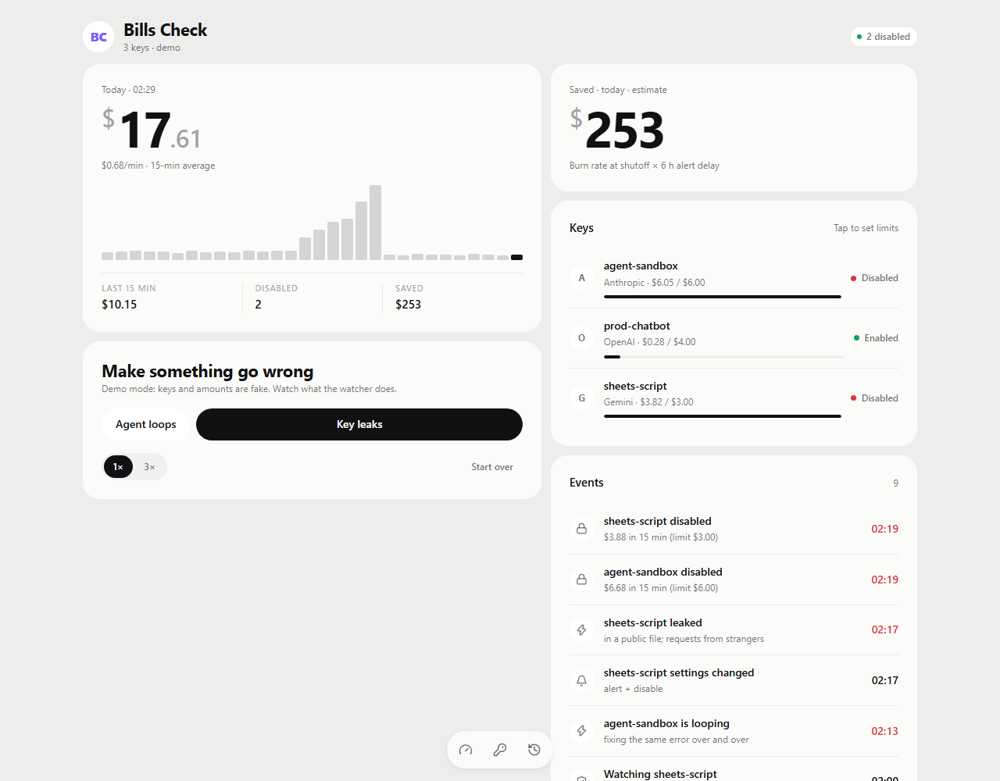
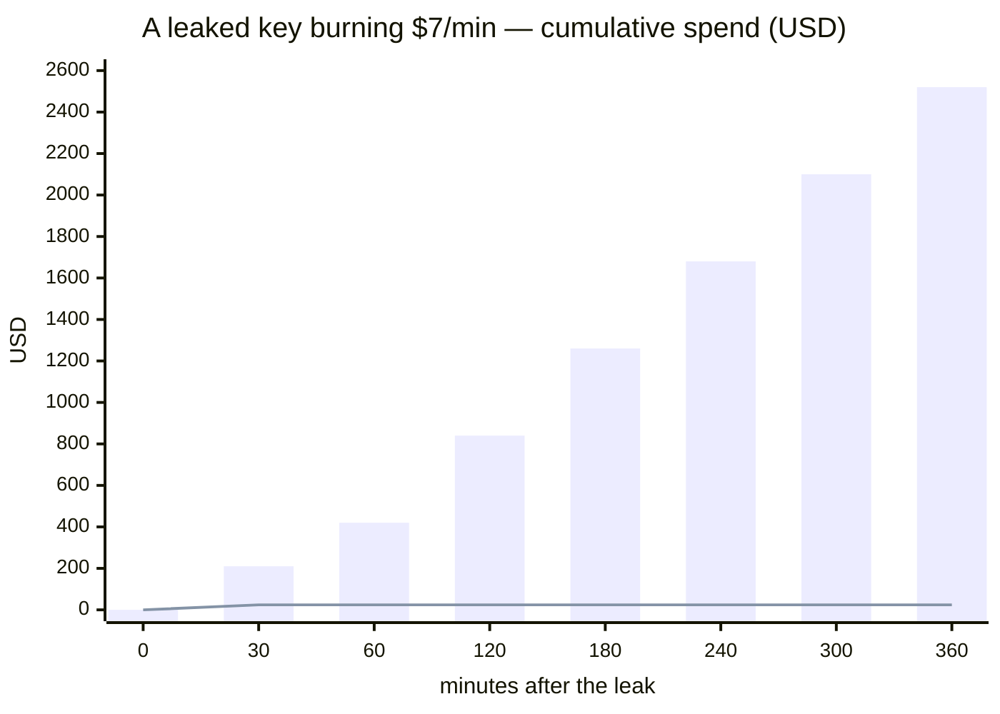
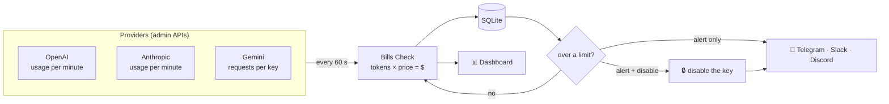
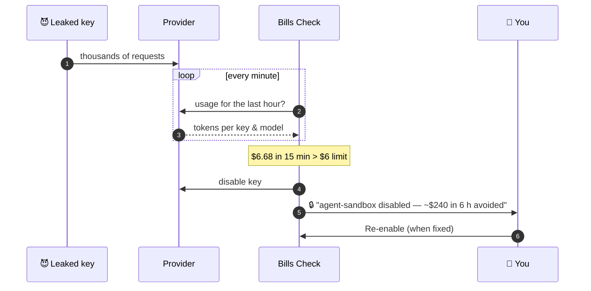
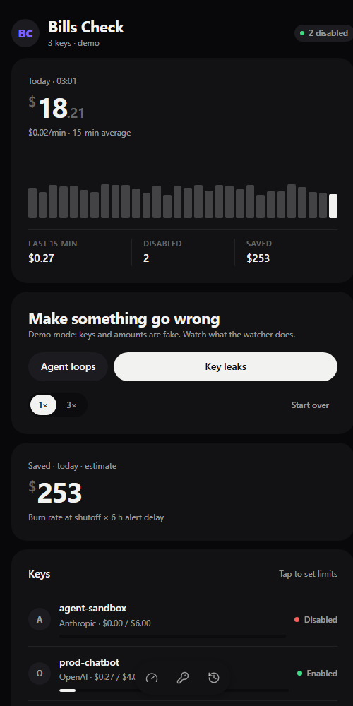
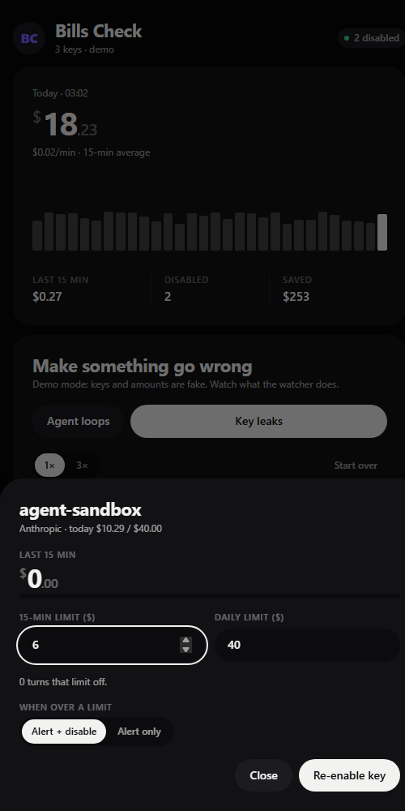
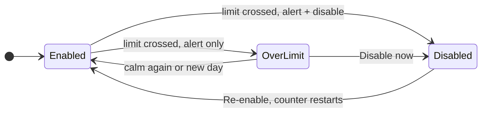

<div align="center">

# 🛡️ Bills Check

**A circuit breaker for your LLM API keys.**<br>
Watches OpenAI, Anthropic and Gemini spend every minute — alerts you, or shuts the key off, before a leak becomes a bill.

[](https://github.com/Han034/bills-check/actions/workflows/ci.yml)


[](LICENSE)

<picture>
  <source media="(prefers-color-scheme: dark)" srcset="docs/dashboard-dark.png">
  
</picture>

</div>

## The problem



<sub>**Bars:** no watcher — the provider's budget alert lands hours later. **Line:** Bills Check disables the key after its 15-minute limit trips. Illustrative numbers.</sub>

Provider budget alerts run on billing data that is **hours late**, spend caps are **per project and per month**, and nothing turns a key off at 3 a.m. Bills Check closes that gap — **no SDK changes, no proxy**, just the providers' admin APIs.

## How it works





## Try it in 30 seconds

```bash
git clone https://github.com/Han034/bills-check.git && cd bills-check
npm install && npm run build
DEMO=1 npm start            # → http://127.0.0.1:8787
```

Demo mode runs three fake keys, one simulated minute per second. Press **Key leaks** or **Agent loops** and watch the watcher work.

<table>
  <tr>
    <td align="center"><br><sub>Works on a phone</sub></td>
    <td align="center"><br><sub>Per-key limits, one tap to re-enable</sub></td>
  </tr>
</table>

## Providers

| | Spend is read from | Delay | "Disable" means | Reversible |
|---|---|:-:|---|:-:|
| **Anthropic** | Usage API · tokens/min × list price | ~5 min | key set to `inactive` | ✅ one click |
| **OpenAI** | Usage API · tokens/min × list price | — | key is **deleted** | ❌ new key needed |
| **Gemini** | Cloud Monitoring · requests/key × your price | ≤ 30 min | key deleted | ✅ within 30 days |

<details>
<summary><b>Anthropic setup</b></summary>

1. Claude Console → **Settings → Admin keys** → create a key (`sk-ant-admin…`). It needs an organization; individual accounts have no Admin API.
2. `.env`: `ANTHROPIC_ADMIN_KEY=sk-ant-admin…`

Active and inactive keys are watched. Console and Workbench usage has no key, so it is not counted.
</details>

<details>
<summary><b>OpenAI setup</b></summary>

1. platform.openai.com → **Settings → Organization → Admin keys** → create a key (`sk-admin-…`).
2. `.env`: `OPENAI_ADMIN_KEY=sk-admin-…`

Every project key is watched; spend covers completions and embeddings.

> [!WARNING]
> OpenAI has no way to switch a key off and on again, so **disabling an OpenAI key deletes it**. The dashboard asks before you turn that on. Service-account keys cannot be deleted through the API; you get a "could not be disabled" alert instead.
</details>

<details>
<summary><b>Gemini setup</b></summary>

1. In the Google Cloud project that owns the keys, enable **Cloud Monitoring API** and **API Keys API**.
2. Create a service account with `roles/monitoring.viewer` and `roles/serviceusage.apiKeysAdmin`, download its JSON key.
3. `.env`:
   ```ini
   GEMINI_PROJECT_ID=my-project
   GOOGLE_APPLICATION_CREDENTIALS=/secrets/gcp.json
   GEMINI_COST_PER_REQUEST=0.002
   ```
4. With Docker, uncomment the secret mount in `docker-compose.yml`.

Google reports **requests per key, not tokens**, so Gemini spend is `requests × GEMINI_COST_PER_REQUEST` — set it to your real average (monthly bill ÷ requests). Keys restricted to other APIs are skipped.
</details>

## Rules

Each key has two limits and a behaviour, all editable in the dashboard.



| | |
|---|---|
| ⏱️ **Window limit** | USD in the last `WINDOW_MIN` minutes (15). Catches sudden runaways. |
| 📅 **Daily limit** | USD since local midnight. Catches slow, steady leaks. |
| 0️⃣ **Limit = 0** | Turns that limit off. |
| 🔔 **Alert only** | One alert per breach, not one per minute. |
| 🔒 **Alert + disable** | Disables the key; if that fails it retries every minute and tells you to do it by hand. |
| 🧪 **`DRY_RUN=1`** | Rules fire and alert, nothing is ever disabled. **Start here for a week.** |
| 💰 **"Saved"** | Burn rate at shutoff × `ALERT_DELAY_MIN` (6 h). An estimate, not a measurement. |

New keys start as **alert only** with `DEFAULT_*` limits; turn on disabling per key.

## Install

```bash
cp .env.example .env        # admin keys, DASHBOARD_PASSWORD, a notification channel
docker compose up -d --build
```

The dashboard is published on `127.0.0.1:8787` only (Basic auth: any user, `DASHBOARD_PASSWORD`). Put a TLS reverse proxy or Tailscale in front to reach it remotely. Without Docker: `npm ci && npm run build && npm start` (Node ≥ 22.13).

### Notifications

| Channel | Setup |
|---|---|
| **Telegram** | [@BotFather](https://t.me/BotFather) → `/newbot` → token. Message the bot, open `https://api.telegram.org/bot<TOKEN>/getUpdates`, copy `chat.id`. Set `TELEGRAM_BOT_TOKEN`, `TELEGRAM_CHAT_ID`. |
| **Slack** | [Incoming webhook](https://api.slack.com/messaging/webhooks) → `SLACK_WEBHOOK_URL` |
| **Discord** | Channel settings → Integrations → Webhooks → `DISCORD_WEBHOOK_URL` |

🔒 key disabled · 🔒 key *could not* be disabled · ⚠️ over a limit · ⚠️ provider unreadable · 🛡️ key re-enabled

<details>
<summary><b>All settings</b></summary>

| Variable | Default | |
|---|---|---|
| `HOST` / `PORT` | `127.0.0.1` / `8787` | A non-loopback `HOST` requires `DASHBOARD_PASSWORD`. |
| `DASHBOARD_PASSWORD` | — | Basic auth password. |
| `DATA_DIR` | `./data` | Where `bills-check.db` lives. |
| `POLL_INTERVAL_SEC` | `60` | ≥ 15. |
| `WINDOW_MIN` | `15` | Rolling window length. |
| `DEFAULT_MODE` | `warn` | `warn` or `kill`, for newly seen keys. |
| `DEFAULT_WINDOW_USD` / `DEFAULT_DAILY_USD` | `5` / `50` | Limits for newly seen keys. |
| `ALERT_DELAY_MIN` | `360` | Feeds the "saved" estimate. |
| `DRY_RUN` | off | Never disable anything. |
| `OPENAI_ADMIN_KEY` · `ANTHROPIC_ADMIN_KEY` | — | |
| `GEMINI_PROJECT_ID` · `GOOGLE_APPLICATION_CREDENTIALS` · `GEMINI_COST_PER_REQUEST` | — · — · `0.002` | |
| `TELEGRAM_BOT_TOKEN` · `TELEGRAM_CHAT_ID` · `SLACK_WEBHOOK_URL` · `DISCORD_WEBHOOK_URL` | — | Any combination. |
| `PRICES_FILE` | — | JSON merged over the price table (below). |
| `DEMO` · `DEMO_MINUTE_MS` | off · `1000` | Fake keys, in-memory database. |
| `TZ` | system | Decides when the "daily" limit resets. |

A missing or invalid setting stops the server with a message saying what to fix.
</details>

<details>
<summary><b>How spend is priced</b></summary>

Tokens × list prices from [`src/pricing.ts`](src/pricing.ts) (checked 2026-10-21), including cache reads/writes and Anthropic web search. Model ids match by **longest prefix**, so dated snapshots find their base model. An **unknown model** is priced as the provider's most expensive one and logged once — a false alarm beats a missed leak. Batch discounts are ignored (over-estimate); long-context surcharges are ignored (under-estimate).

Override or add prices (USD per 1M tokens):

```json
{ "openai": { "gpt-7-preview": { "input": 5, "cacheRead": 0.5, "output": 25 } } }
```
</details>

<details>
<summary><b>HTTP API</b></summary>

| | | |
|---|---|---|
| `GET` | `/healthz` | liveness (no auth) |
| `GET` | `/api/state` | totals, 30-min bars, keys with spend, provider health |
| `GET` | `/api/events?limit=50` | event log, newest first |
| `PATCH` | `/api/keys/:id` | `{ "mode": "kill"\|"warn", "windowLimit": 5, "dailyLimit": 50 }` |
| `POST` | `/api/keys/:id/disable` | disable now |
| `POST` | `/api/keys/:id/restore` | re-enable |

Key ids are `provider:externalId` — URL-encode the colon. `/#key=<id>` opens that key in the dashboard.

```bash
curl -u :$DASHBOARD_PASSWORD -X PATCH http://127.0.0.1:8787/api/keys/anthropic%3Aapikey_01AbC \
  -H 'content-type: application/json' -d '{"mode":"kill","windowLimit":10}'
```
</details>

## Security

> [!CAUTION]
> Admin keys can do **everything** in your organization. Bills Check refuses to start reachable from outside without a password, never reads or stores a key's secret value (only ids and names), and keeps `.env` and `data/` out of git and Docker builds. Give the Gemini service account only the two roles above.

## Known limits

- ⏳ Detection is only as fast as the provider's data: ~5 min (Anthropic), up to 30 min (Gemini).
- 🗑️ OpenAI keys can only be deleted, not paused.
- 📉 OpenAI images, audio, tools and vector stores are not counted yet; Gemini spend is request-based.
- 🧪 Built against the official API docs, **not yet run against live accounts** — the Gemini `credential_id` label format (`apikey:<uid>`) and OpenAI usage latency are unconfirmed. Issues welcome.

## Development

```bash
DEMO=1 npm run dev     # server on :8787, restarts on change
npm run dev:web        # dashboard on :5173, proxies /api
npm test               # vitest — fake fetch, manual clock, in-memory SQLite
npm run typecheck
```

```
src/
  watcher.ts      poll → store → rules → disable / alert
  rules.ts        pure decisions
  providers/      openai · anthropic · gemini · demo
  pricing.ts      price table, prefix matching
  notify.ts       telegram · slack · discord
  db.ts           node:sqlite (no native build)
  http.ts         Fastify API, Basic auth, static dashboard
web/              dashboard — vanilla TypeScript, no UI framework
```

Adding a provider = implement `Provider` in [`src/types.ts`](src/types.ts) (`listKeys`, `fetchUsage`, `disableKey`, optional `enableKey`) and register it in [`src/main.ts`](src/main.ts).

## Roadmap

- [ ] Reversible disabling for OpenAI (read-only scopes or project spend limit)
- [ ] OpenAI image / audio usage
- [ ] Month-end forecast per key
- [ ] "Re-enable" button inside Telegram alerts
- [ ] Azure OpenAI, AWS Bedrock, Vertex AI

## License

[MIT](LICENSE) · Icons: [Lucide](https://lucide.dev) (ISC)
