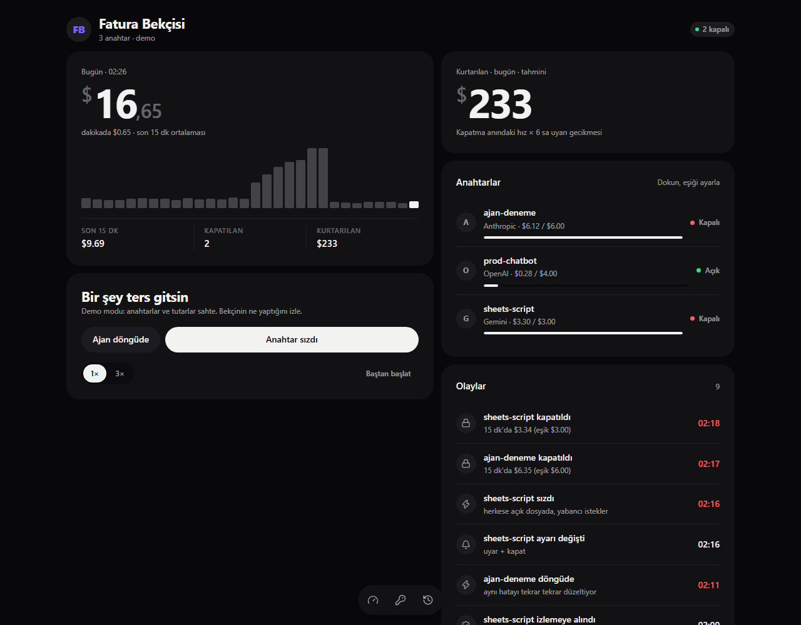

# Fatura Bekçisi

**LLM API anahtarların için devre kesici.** Kendi sunucunda çalışır, OpenAI, Anthropic ve Gemini anahtarlarının harcamasını dakikada bir okur ve eşik aşılınca seni uyarır ya da anahtarı kapatır. Uygulamanın kodunda değişiklik gerektirmez, araya proxy de koymaz.

> *English summary:* a self-hosted circuit breaker for LLM API keys. It polls the OpenAI, Anthropic and Gemini admin APIs every minute, estimates spend per key, and alerts you (Telegram / Slack / Discord) or disables the key when a threshold is crossed. It needs no SDK changes and no proxy. The UI and docs are in Turkish.



---

## İçindekiler

- [Neden?](#neden)
- [Nasıl çalışır?](#nasıl-çalışır)
- [Hızlı deneme (demo)](#hızlı-deneme-demo)
- [Kurulum](#kurulum)
- [Sağlayıcıları bağlamak](#sağlayıcıları-bağlamak)
- [Bildirim kanalları](#bildirim-kanalları)
- [Kurallar ve davranış](#kurallar-ve-davranış)
- [Yapılandırma referansı](#yapılandırma-referansı)
- [Harcama nasıl hesaplanır?](#harcama-nasıl-hesaplanır)
- [HTTP API](#http-api)
- [Güvenlik](#güvenlik)
- [Bilinen sınırlar](#bilinen-sınırlar)
- [Geliştirme](#geliştirme)
- [Proje yapısı](#proje-yapısı)
- [Yol haritası](#yol-haritası)
- [Lisans](#lisans)

---

## Neden?

Bir API anahtarı herkese açık bir repoya, bir Google Sheets betiğine ya da istemci tarafı koda sızabilir. Bir ajan da aynı hatayı düzeltmeye çalışırken saatlerce döngüde kalabilir. İki durumda da harcama dakikalar içinde katlanır.

Sağlayıcıların kendi önlemleri bu durumda yetersiz kalır:

- **Bütçe uyarıları gecikmeli gelir.** Fatura verisi saatler sonra işlenir; uyarı geldiğinde para çoktan harcanmıştır.
- **Harcama sınırları kabadır.** Proje ya da organizasyon düzeyindedir, aylıktır ve anahtar bazında değildir.
- **Anahtarı otomatik kapatan bir şey yoktur.** Gece 3'te bir insanın uyanıp konsola girmesi gerekir.

Fatura Bekçisi bu açığı kapatır. Harcamayı anahtar bazında dakikada bir okur, belirlediğin eşiği aşan anahtarı otomatik kapatır ve seni haberdar eder. Tek kişilik geliştiriciler ve küçük ekipler için tasarlandı.

## Nasıl çalışır?

```
                ┌───────────────────────── her POLL_INTERVAL_SEC (60 sn) ─────────────────────────┐
                │                                                                                 │
  OpenAI  Admin API ─┐                                                                            │
  Anthropic Admin API ┼─▶ anahtar listesi + dakikalık kullanım ─▶ SQLite ─▶ kurallar ─┬─ altında ─┘
  Google Cloud API'leri┘    (token × fiyat ya da istek × birim fiyat)                  │
                                                                                       ├─ "sadece uyar" ─▶ bildirim
                                                                                       └─ "uyar + kapat" ─▶ anahtarı kapat + bildirim
```

1. **Anahtarları bulur.** Her sağlayıcının yönetici API'sinden anahtar listesini 10 dakikada bir yeniler. Yeni anahtarlar varsayılan ayarlarla izlemeye alınır.
2. **Kullanımı okur.** Dakikalık, anahtar başına kullanım verisini çeker. Sağlayıcılar son dakikaların verisini sonradan düzeltebildiği için her turda son 60 dakikayı yeniden okur ve kayıtları günceller.
3. **Tutara çevirir.** Anthropic ve OpenAI için token sayısını model fiyatıyla çarpar; Gemini için istek sayısını birim fiyatla çarpar.
4. **Kuralları uygular.** Kayan pencere eşiğine (varsayılan 15 dakika) ve günlük eşiğe bakar.
5. **Harekete geçer.** Anahtarı uyarır ya da sağlayıcının API'siyle devre dışı bırakır. Panelde, olay günlüğünde ve bildirim kanallarında görünür.

## Hızlı deneme (demo)

Hiçbir hesaba bağlanmadan paneli denemek için:

```bash
git clone https://github.com/Han034/fatura-bekcisi.git
cd fatura-bekcisi
npm install
npm run build
DEMO=1 npm start
```

http://127.0.0.1:8787 adresini aç. Demo modunda üç sahte anahtar vardır ve simüle edilen her dakika 1 saniye sürer.

- **Anahtar sızdı:** Gemini anahtarı yabancı isteklerle dolar ve dakikalar içinde kapatılır.
- **Ajan döngüde:** Anthropic anahtarının harcaması yavaş yavaş tırmanır ve pencere eşiğine takılır.
- Bir anahtara dokunup eşiğini ya da davranışını değiştirebilir, kapatılan anahtarı yeniden açabilirsin.

> Windows PowerShell'de: `$env:DEMO=1; npm start`

## Kurulum

### Gereksinimler

- **Docker** ya da **Node.js 22.13+**. Veritabanı Node'un yerleşik `node:sqlite` modülünü kullanır, bu yüzden yerel derleme gerekmez.
- En az bir sağlayıcının **yönetici anahtarı** (ayrıntılar [aşağıda](#sağlayıcıları-bağlamak)).
- İsteğe bağlı ama önerilir: bir bildirim kanalı.

### Docker ile (önerilen)

```bash
git clone https://github.com/Han034/fatura-bekcisi.git
cd fatura-bekcisi
cp .env.example .env      # düzenle: anahtarlar, DASHBOARD_PASSWORD, bildirim kanalı
docker compose up -d --build
```

- Panel `http://127.0.0.1:8787` adresinde açılır; giriş için kullanıcı adı fark etmez, parola `DASHBOARD_PASSWORD`.
- Veriler `bekci-data` Docker biriminde kalır.
- Panel yalnızca bu makineden erişilecek şekilde yayınlanır. Uzaktan erişim için önüne TLS'li bir reverse proxy (Caddy, Nginx, Traefik) ya da Tailscale koy.

### Node ile

```bash
npm ci
npm run build
cp .env.example .env      # düzenle
npm start                 # .env dosyasını kendisi okur
```

Kalıcı çalışması için systemd, pm2 ya da NSSM (Windows) gibi bir servis yöneticisi kullan.

### İlk hafta: deneme modu

`.env.example` dosyası `DRY_RUN=1` ile gelir. Bu modda kurallar çalışır ve bildirimler gelir, ama **hiçbir anahtar kapatılmaz**. Bir hafta boyunca normal kullanımının panelde nasıl göründüğüne bak, eşikleri buna göre ayarla, sonra `DRY_RUN=0` yap.

Yeni görülen anahtarlar da varsayılan olarak `DEFAULT_MODE=warn` ile başlar. Kapatma davranışını panelden anahtar bazında açarsın.

## Sağlayıcıları bağlamak

| | Harcama nasıl okunur | Veri gecikmesi | "Kapat" ne yapar | Geri açılır mı |
|---|---|---|---|---|
| **Anthropic** | Usage API, dakikalık token sayıları × liste fiyatı | ~5 dk | Anahtar `inactive` yapılır | ✅ Panelden, tek tıkla |
| **OpenAI** | Usage API, dakikalık token sayıları × liste fiyatı | belgelenmemiş | Anahtar **silinir** | ❌ Yeni anahtar gerekir |
| **Gemini** | Cloud Monitoring, anahtar başına istek × birim fiyat | 30 dk'ya kadar | Anahtar silinir | ✅ 30 gün içinde |

### Anthropic

1. [Claude Console](https://platform.claude.com) → **Settings → Admin keys** sayfasından bir yönetici anahtarı oluştur (`sk-ant-admin...`). Bunun için organizasyon yöneticisi olman gerekir; bireysel hesaplarda yönetici API'si yoktur.
2. `.env` dosyasına `ANTHROPIC_ADMIN_KEY=...` olarak ekle.

Bekçi, durumu `active` ya da `inactive` olan anahtarları izler; arşivlenmiş ve süresi dolmuş anahtarları atlar. Console ve Workbench üzerinden yapılan kullanım bir anahtara bağlı olmadığı için sayılmaz.

### OpenAI

1. [platform.openai.com](https://platform.openai.com) → **Settings → Organization → Admin keys** sayfasından bir yönetici anahtarı oluştur (`sk-admin-...`).
2. `.env` dosyasına `OPENAI_ADMIN_KEY=...` olarak ekle.

Bekçi tüm projelerdeki proje anahtarlarını listeler. Harcama, chat/completions ve embeddings kullanımından hesaplanır.

> ⚠️ **OpenAI'da bir anahtarı kapatıp yeniden açmanın yolu yok.** Bu yüzden "uyar + kapat" seçeneği OpenAI anahtarlarında **anahtarı siler**. Panel bu seçenek için onay ister. Silinen anahtar geri gelmez ve uygulamanda yeni anahtar kullanman gerekir. Servis hesaplarına ait anahtarlar API üzerinden silinemez; bekçi bu durumu "KAPATILAMADI — elle kapat" olarak bildirir.

### Gemini (Google AI Studio / Google Cloud)

Gemini API anahtarları bir Google Cloud projesine aittir. AI Studio'da oluşturulan anahtarlar da bir projeye bağlıdır.

1. Projede şu API'leri etkinleştir: **Cloud Monitoring API** ve **API Keys API**.
2. Bir servis hesabı oluştur ve şu rolleri ver:
   - `roles/monitoring.viewer`: anahtar başına istek sayılarını okumak için
   - `roles/serviceusage.apiKeysAdmin`: anahtarları listelemek, silmek ve geri getirmek için
3. Servis hesabı için bir JSON anahtarı indir.
4. `.env` dosyasına ekle:
   ```ini
   GEMINI_PROJECT_ID=projenin-kimligi
   GOOGLE_APPLICATION_CREDENTIALS=/secrets/gcp.json
   GEMINI_COST_PER_REQUEST=0.002
   ```
5. Docker kullanıyorsan `docker-compose.yml` dosyasındaki ilgili `volumes` satırının yorumunu kaldırarak JSON dosyasını konteynere bağla. Bekçi Google Cloud üzerinde çalışıyorsa servis hesabı metadata sunucusundan otomatik bulunur.

Google anahtar başına token sayısı vermiyor, yalnızca istek sayısı veriyor. Bu yüzden Gemini tutarı **istek sayısı × `GEMINI_COST_PER_REQUEST`** olarak hesaplanan kaba bir tahmindir. Kendi ortalama istek maliyetini bulup (aylık Gemini faturası ÷ istek sayısı) bu değeri ona göre ayarla. Yalnızca başka API'lerle kısıtlanmış anahtarlar (örneğin yalnızca Maps) izlenmez.

## Bildirim kanalları

Birden fazla kanal aynı anda kullanılabilir. Bir kanal hata verirse diğerleri yine gönderilir.

| Olay | Önem |
|---|---|
| Anahtar kapatıldı (tahmini kurtarılan tutarla birlikte) | 🔒 kritik |
| Anahtar **kapatılamadı**, elle kapatman gerekiyor (en fazla saatte bir tekrarlanır) | 🔒 kritik |
| Eşik aşıldı ("sadece uyar" modu ya da deneme modu) | ⚠️ uyarı |
| Sağlayıcı okunamıyor (en fazla saatte bir tekrarlanır) | ⚠️ uyarı |
| Anahtar panelden yeniden açıldı | 🛡️ bilgi |

**Telegram**
1. [@BotFather](https://t.me/BotFather) ile `/newbot` komutunu çalıştırıp bir bot oluştur ve token'ı al.
2. Bota bir mesaj gönder, sonra `https://api.telegram.org/bot<TOKEN>/getUpdates` adresini aç ve `chat.id` değerini al. Grup kullanacaksan botu gruba ekle; grup kimliği eksiyle başlar.
3. `.env` dosyasına `TELEGRAM_BOT_TOKEN` ve `TELEGRAM_CHAT_ID` olarak ekle.

**Slack**: Bir [Incoming Webhook](https://api.slack.com/messaging/webhooks) oluştur ve `SLACK_WEBHOOK_URL` olarak ekle.

**Discord**: Kanal ayarları → Integrations → Webhooks bölümünden bir webhook oluştur ve `DISCORD_WEBHOOK_URL` olarak ekle.

## Kurallar ve davranış

Her anahtarın iki eşiği ve bir davranışı vardır. Hepsi panelden anahtar bazında değiştirilir.

- **Pencere eşiği (`windowLimit`).** Son `WINDOW_MIN` dakikadaki (varsayılan 15) harcama bu tutarı geçerse kural tetiklenir. Sızıntı ve döngü gibi ani kaçakları yakalar.
- **Günlük eşik (`dailyLimit`).** Sunucu saatine göre gece yarısından bu yana harcanan tutar bu tutarı geçerse kural tetiklenir. Yavaş ama sürekli sızıntıları yakalar. Saat dilimini Docker'da `TZ=Europe/Istanbul` ile ayarlayabilirsin.
- Bir eşiği **0** yapmak o kuralı kapatır.

**"Sadece uyar" modu**
- Her aşım için **bir kez** bildirim gider; her dakika tekrarlanmaz.
- Pencere uyarısı, harcama eşiğin yarısının altına inince yeniden kurulur. Günlük uyarı gece yarısı yeniden kurulur.
- Pencere uyarısından sonra günlük eşik de aşılırsa bu ayrı bir uyarı olarak gönderilir.

**"Uyar + kapat" modu**
- Anahtar sağlayıcı üzerinden devre dışı bırakılır, durumu **Kapalı** olur ve kritik bildirim gider.
- Kapatma başarısız olursa (yetki yok, ağ hatası) bekçi her turda yeniden dener. "KAPATILAMADI — elle kapat" bildirimi en fazla saatte bir gönderilir.
- Deneme modunda (`DRY_RUN=1`) kapatma yapılmaz; davranış "sadece uyar" ile aynıdır.

**Panelden yapılan işlemler**
- **Yeniden aç:** Anahtarı sağlayıcıda tekrar etkinleştirir (Anthropic ve Gemini). Anahtarın önceki harcaması artık sayılmaz, böylece aynı aşım yüzünden hemen yeniden kapanmaz.
- **Şimdi kapat:** Harcama ne olursa olsun anahtarı hemen kapatır. Acil fren olarak kullanılır.

**"Kurtarılan" tutarı.** Kapatma anındaki harcama hızı × `ALERT_DELAY_MIN` (varsayılan 6 saat) olarak hesaplanır: "bekçi olmasaydı sağlayıcının uyarısı gelene kadar bu hızla ne giderdi" sorusunun cevabıdır. Bir tahmindir, ölçüm değildir.

## Yapılandırma referansı

Tüm ayarlar ortam değişkenleriyle verilir. `.env` dosyası otomatik okunur.

| Değişken | Varsayılan | Açıklama |
|---|---|---|
| `HOST` | `127.0.0.1` | Dinlenecek adres. Loopback dışında bir adres verirsen `DASHBOARD_PASSWORD` zorunludur. |
| `PORT` | `8787` | |
| `DASHBOARD_PASSWORD` | — | Panel parolası (HTTP Basic auth; kullanıcı adı fark etmez). |
| `DATA_DIR` | `./data` | SQLite dosyasının konumu (`bekci.db`). |
| `POLL_INTERVAL_SEC` | `60` | Okuma aralığı (en az 15). |
| `WINDOW_MIN` | `15` | Kayan pencerenin uzunluğu (dakika). |
| `DEFAULT_MODE` | `warn` | Yeni anahtarların davranışı: `warn` ya da `kill`. |
| `DEFAULT_WINDOW_USD` | `5` | Yeni anahtarların pencere eşiği. |
| `DEFAULT_DAILY_USD` | `50` | Yeni anahtarların günlük eşiği. |
| `ALERT_DELAY_MIN` | `360` | "Kurtarılan" tahmininde kullanılan uyarı gecikmesi. |
| `DRY_RUN` | kapalı | `1` olursa hiçbir anahtar kapatılmaz. |
| `OPENAI_ADMIN_KEY` | — | OpenAI organizasyon yönetici anahtarı. |
| `ANTHROPIC_ADMIN_KEY` | — | Anthropic yönetici anahtarı. |
| `GEMINI_PROJECT_ID` | — | Gemini anahtarlarının bulunduğu Google Cloud projesi. |
| `GOOGLE_APPLICATION_CREDENTIALS` | — | Servis hesabının JSON dosyasının yolu. |
| `GEMINI_COST_PER_REQUEST` | `0.002` | Gemini için istek başına tahmini maliyet (USD). |
| `TELEGRAM_BOT_TOKEN`, `TELEGRAM_CHAT_ID` | — | İkisi birlikte verilmeli. |
| `SLACK_WEBHOOK_URL` | — | |
| `DISCORD_WEBHOOK_URL` | — | |
| `PRICES_FILE` | — | Fiyat tablosuna ekleme ya da değişiklik yapan JSON dosyası ([ayrıntılar](#harcama-nasıl-hesaplanır)). |
| `DEMO` | kapalı | Sahte anahtarlarla demo modu. Veritabanı bellekte tutulur. |
| `DEMO_MINUTE_MS` | `1000` | Demo modunda simüle edilen bir dakikanın gerçek süresi. |
| `LOG_LEVEL` | `info` | Sunucu günlük düzeyi. |

Yanlış ya da eksik bir ayar varsa bekçi başlamaz ve hatanın ne olduğunu açıkça yazar. Örneğin izlenecek hiçbir sağlayıcı verilmemişse ya da panel dışarıya açık olup parola yoksa açılmaz.

## Harcama nasıl hesaplanır?

Anthropic ve OpenAI token sayılarını model bazında verir. Bekçi bu sayıları [`src/pricing.ts`](src/pricing.ts) dosyasındaki liste fiyatlarıyla çarpar. Fiyatlar 21 Ekim 2026'da resmi fiyat sayfalarından kontrol edildi.

- **Hesaba katılanlar:** önbelleğe yazma (Anthropic'in 5 dakikalık ve 1 saatlik önbelleği, OpenAI'ın 30 dakikalık ve 12 saatlik önbelleği), önbellekten okuma ve Anthropic web araması (1000 istek başına 10 $).
- **Model eşleşmesi:** Model adı tablodaki **en uzun önekle** eşleştirilir. Böylece `gpt-5.4-mini-2026-03-05` gibi tarihli sürümler kendi temel modelinin fiyatını bulur.
- **Bilinmeyen model:** Tabloda olmayan bir model, sağlayıcının **en pahalı** modelinin fiyatıyla hesaplanır (yanlış alarm, kaçırılan bir sızıntıdan iyidir). Olay günlüğüne bir kez yazılır.
- **Hesaba katılmayanlar:**
  - **Batch indirimi:** tutar olduğundan yüksek çıkar. Bir fren için bu güvenli taraftır.
  - **Çok uzun istemlerin ek ücreti:** tutar olduğundan düşük çıkar.
  - **Haiku 5.5'in 100K token üstü fiyatı:** tutar olduğundan düşük çıkar.
- **Gemini:** istek sayısı × `GEMINI_COST_PER_REQUEST`. Google, Gemini için Aralık 2026 ve Ocak 2027'de fiyat artışı duyurdu; bu değeri buna göre güncelle.

Fiyat eklemek ya da değiştirmek için bir JSON dosyası hazırlayıp yolunu `PRICES_FILE` ile ver. Değerler 1 milyon token başına USD'dir ve varsayılan tablonun üzerine yazılır:

```json
{
  "openai": {
    "gpt-7-preview": { "input": 5, "cacheRead": 0.5, "output": 25 }
  },
  "anthropic": {
    "claude-sonnet-5-5": { "input": 2, "cacheWrite": 2.5, "cacheWriteLong": 4, "cacheRead": 0.1, "output": 10 }
  }
}
```

Bu tutarlar **tahmindir**. Kesin fatura için sağlayıcının faturalama sayfasına bak.

## HTTP API

Paneli besleyen API, betiklerden de kullanılabilir. `DASHBOARD_PASSWORD` tanımlıysa her istekte Basic auth gerekir; `/healthz` hariç.

| Yöntem | Yol | Açıklama |
|---|---|---|
| `GET` | `/healthz` | Canlılık kontrolü, `{ "ok": true }` döner. |
| `GET` | `/api/state` | Toplamlar, son 30 dakikalık grafik verisi, anahtarlar (pencere ve günlük harcamayla birlikte) ve sağlayıcı durumu. |
| `GET` | `/api/events?limit=50` | Olay günlüğü, en yenisi önce (en fazla 500). |
| `PATCH` | `/api/keys/:id` | `{ "mode": "kill" \| "warn", "windowLimit": 5, "dailyLimit": 50 }` alanlarından herhangi biri. |
| `POST` | `/api/keys/:id/disable` | Anahtarı hemen kapatır. |
| `POST` | `/api/keys/:id/restore` | Kapatılan anahtarı yeniden açar. |
| `POST` | `/api/demo/scenario` | Yalnızca demo modunda: `{ "name": "leak" \| "loop" \| "reset" }`. |

Anahtar kimliği `sağlayıcı:dış-kimlik` biçimindedir, örneğin `anthropic:apikey_01AbC...`. URL'de `:` karakterini `%3A` olarak kodla.

```bash
curl -u :$DASHBOARD_PASSWORD -X PATCH http://127.0.0.1:8787/api/keys/anthropic%3Aapikey_01AbC \
  -H 'content-type: application/json' -d '{"mode":"kill","windowLimit":10}'
```

## Güvenlik

Yönetici anahtarları organizasyonundaki **her şeye** erişebilir. Bu servisi buna göre koru:

- **Paneli dışarıya açma.** Bekçi, dışarıdan erişilebilir bir adreste parolasız başlamayı reddeder. Docker Compose dosyası paneli yalnızca `127.0.0.1` üzerinde yayınlar. Uzaktan erişim gerekiyorsa TLS ve ek kimlik doğrulama (VPN, Tailscale, SSO proxy) kullan.
- **Gizli dosyaları koru.** `.env` dosyası, servis hesabının JSON dosyası ve `/data` birimi git'e, yedek paylaşımlarına ya da ekran görüntülerine girmemeli. `.gitignore` ve `.dockerignore` bu dosyaları zaten dışarıda bırakır.
- **Yetkiyi sınırla.** Gemini için servis hesabına yalnızca yukarıdaki iki rolü ver. Bekçinin kendisi hiçbir anahtarın gizli değerini okumaz ve saklamaz; yalnızca kimliklerini ve adlarını tutar.
- **Kapatmayı gözden geçir.** Bekçi bir anahtarı kapattığında uygulaman durur; bu tasarım gereğidir. Üretimdeki kritik anahtarlar için önce "sadece uyar" modunu ve geniş eşikleri dene.

Bir güvenlik açığı bulursan lütfen herkese açık bir issue açmak yerine depo sahibine doğrudan ulaş.

## Bilinen sınırlar

- **Gecikme sağlayıcıya bağlı.** Anthropic verisi yaklaşık 5 dakika, Gemini verisi 30 dakikaya kadar gecikebiliyor. Bekçi kaçağı bu gecikme kadar geç görür; yine de saatler süren fatura gecikmesinden çok daha erkendir.
- **OpenAI'da kapatmak silmek demek.** Kapatma geri alınamaz; yeni anahtar oluşturman gerekir.
- **Kapsam:** OpenAI için yalnızca completions ve embeddings kullanımı sayılır. Görsel, ses, araç çağrısı ve vektör deposu ücretleri hesaba katılmaz.
- **Gemini tutarı istek sayısına dayalı.** Uzun istemleri çok olan iş yüklerinde `GEMINI_COST_PER_REQUEST` değerini mutlaka ayarla.
- **Henüz gerçek hesaplarla doğrulanmadı.** Aşağıdaki ayrıntılar resmi belgelere göre yazıldı ama gerçek hesaplarla denenmedi. Sorun görürsen lütfen issue aç.
  - Gemini'de Cloud Monitoring'in `credential_id` etiketinin biçimi (`apikey:<uid>` varsayılıyor).
  - OpenAI kullanım verisinin gecikmesi.
- **Tek kullanıcı.** Panelin tek bir parolası var; rol ve kullanıcı yönetimi yok.

## Geliştirme

```bash
npm install
DEMO=1 npm run dev     # sunucu, :8787, değişiklikte yeniden başlar
npm run dev:web        # panel, :5173 (/api isteklerini :8787'ye yönlendirir)
npm test               # vitest
npm run typecheck      # sunucu ve panel
npm run build          # dist/web (Vite) + dist/server (tsc)
```

Testler gerçek ağa çıkmaz:
- Sağlayıcı adaptörleri sahte bir `fetch` fonksiyonuyla,
- İzleme döngüsü elle ilerletilen bir saat (`ManualClock`) ve bellekteki SQLite ile,
- Kurallar saf fonksiyon olarak test edilir.

Yeni bir sağlayıcı eklemek için [`src/types.ts`](src/types.ts) dosyasındaki `Provider` arayüzünü uygula (`listKeys`, `fetchUsage`, `disableKey`, isteğe bağlı olarak `enableKey`) ve [`src/main.ts`](src/main.ts) dosyasında kaydet.

## Proje yapısı

```
src/
  main.ts            yapılandırmayı okur, servisleri bağlar, zamanlayıcıyı ve sunucuyu başlatır
  config.ts          ortam değişkenleri ve doğrulama
  watcher.ts         okuma → kayıt → kural → kapatma/uyarı döngüsü; panelin görüntüsü (snapshot)
  rules.ts           saf karar mantığı (eşikler, tek seferlik uyarı, yeniden kurma)
  db.ts              SQLite şeması ve sorgular (node:sqlite)
  pricing.ts         model fiyat tablosu ve önek eşleştirme
  notify.ts          Telegram / Slack / Discord
  http.ts            Fastify: API, Basic auth, statik panel
  providers/
    anthropic.ts     Usage API + anahtar durumu (inactive/active)
    openai.ts        Usage API + proje anahtarı silme
    gemini.ts        Cloud Monitoring + API Keys (sil/geri getir)
    demo.ts          sahte, tekrarlanabilir veri ve senaryolar
web/
  index.html, main.ts, styles.css panel (vanilla TypeScript, bağımlılıksız; simgeler Lucide, ISC)
test/                             vitest
```

## Yol haritası

- [ ] OpenAI için geri alınabilir kapatma (anahtar yetkilerini salt okunur yapmak, proje harcama sınırı)
- [ ] OpenAI görsel ve ses kullanımını da hesaba katmak
- [ ] Anahtar ya da proje bazında, aylık bütçeye göre tahmin ("bu hızla ay sonunda $X")
- [ ] Bildirimlerden doğrudan "yeniden aç" (Telegram satır içi düğmesi)
- [ ] Azure OpenAI, AWS Bedrock ve Google Vertex AI desteği
- [ ] Panel için İngilizce arayüz

## Lisans

[MIT](LICENSE)
